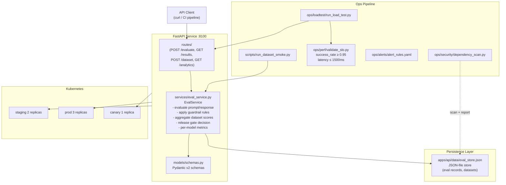
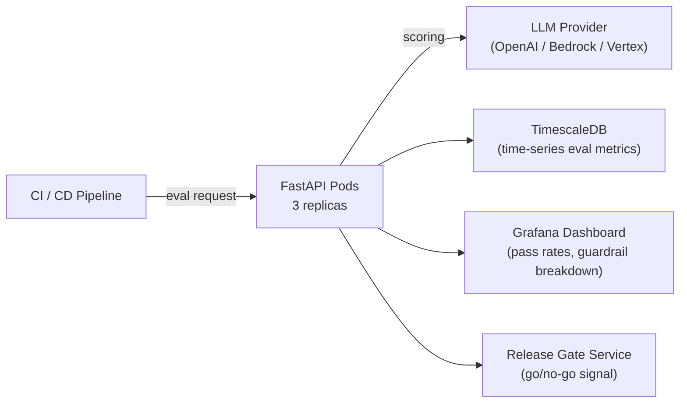

# Architecture — LLM Eval Guardrails Platform

## Overview

The LLM Eval Guardrails Platform is a FastAPI service for evaluating LLM prompt/response pairs against configurable guardrail thresholds. It supports multi-dataset evaluation runs, release-gate scoring, and per-model performance comparison — all without a real LLM dependency (simulated scoring for demo portability).

## Component Diagram



## Data Flow

1. **Dataset Registration** — Client POSTs dataset with prompt/response pairs
2. **Evaluation Run** — `EvalService` scores each pair: relevance, coherence, toxicity, factuality
3. **Guardrail Check** — Scores are compared against configured thresholds; failing pairs are flagged
4. **Release Gate** — Aggregate pass rate determines go/no-go for model deployment
5. **Analytics** — Per-model pass rates, failure category breakdown, trend over time

## Guardrail Dimensions

| Dimension  | What is checked                               | Default threshold |
| ---------- | --------------------------------------------- | ----------------- |
| Toxicity   | Harmful / offensive content in response       | < 0.1 score       |
| Relevance  | Response addresses the prompt                 | > 0.7 score       |
| Coherence  | Response is grammatically / logically sound   | > 0.6 score       |
| Factuality | Response is factually consistent with context | > 0.8 score       |

## Key Design Decisions

| Decision                        | Rationale                                                           |
| ------------------------------- | ------------------------------------------------------------------- |
| Simulated scoring               | Enables full pipeline testing without LLM API keys or cost          |
| Per-model namespacing           | Allows side-by-side comparison of model versions                    |
| Release gate as first-class API | CI pipelines can call the gate endpoint directly as a quality check |
| Pydantic v2 validation          | Ensures eval payloads are well-formed before processing             |

## Production Architecture (Target)



## Directory Map

```
llm-eval-guardrails-platform/
├── apps/api/
│   ├── app/
│   │   ├── main.py              # FastAPI app, /health
│   │   ├── routes/              # HTTP layer
│   │   ├── services/eval_service.py
│   │   └── models/schemas.py
│   ├── scripts/run_dataset_smoke.py
│   └── tests/test_eval_service.py
├── deploy/k8s/
│   ├── staging/ prod/ canary/
├── ops/
│   ├── alerts/ loadtest/ perf/ runbooks/ security/
└── .github/workflows/ci.yml
```
